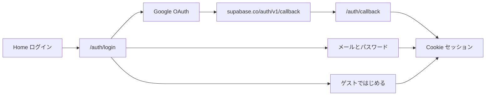

# Google 認証＋ログイン1ページ統合

## 原因

Google Cloud 側は設定済みでも、現行 Web には Google ボタンも OAuth コールバックも無い。[`login-form.tsx`](apps/web/src/components/login-form.tsx) はメール／パスワード＋ゲストのみ。ホームは「ログイン」と「ゲスト」が並んでいる。

## 完成イメージ

よくある並び（上から）:

1. **Google で続ける**
2. 区切り（または）
3. **メール／パスワード** フォーム＋ログイン
4. 新規登録へのリンク（既存 `/auth/sign-up` は残す。ゲスト本登録は現行どおり `/auth/upgrade`）
5. 区切りのあと **ゲストではじめる**（既存 [`GuestStartButton`](apps/web/src/components/auth/GuestStartButton.tsx)）

入口は既存の「ログイン」→ `/auth/login` のまま。ホームからゲスト専用ボタンは外す。

## 実装

### 1. OAuth コールバック（必須）

[`apps/web/src/app/[locale]/auth/callback/route.ts`](apps/web/src/app/[locale]/auth/callback/route.ts) を新設。

- `code` クエリを受け [`createClient`](apps/web/src/lib/server.ts) で `exchangeCodeForSession`
- `next` は `/` 始まりのみ許可（[`confirm/route.ts`](apps/web/src/app/[locale]/auth/confirm/route.ts) と同じオープンリダイレクト防止）
- 失敗時は `/auth/error`

Google の「承認済みリダイレクト URI」は **変えない**（`https://<project>.supabase.co/auth/v1/callback`）。アプリ側 `redirectTo` は `origin + /auth/callback`（locale 付きは ja 既定でプレフィックスなし）。

### 2. Google ボタン＋ログイン UI 統合

- 小さな部品（例: `GoogleSignInButton`）で  
  `signInWithOAuth({ provider: "google", options: { redirectTo: \`${origin}/auth/callback?next=...\` } })`  
  （着地は既存の display settings と同様、既定 `/` またはログイン後着地。初回は `/` で足りる）
- [`LoginForm`](apps/web/src/components/login-form.tsx) を上記レイアウトに再構成
- [`page.tsx`（ホーム）](apps/web/src/app/[locale]/page.tsx): 未ログイン時は **ログインボタンのみ**（`GuestStartButton` 削除）
- サインアップ画面にも同じ Google ボタンを置き、入口をログインに寄せても Google 新規作成は可能にする

### 3. 文言・仕様・人がやる Dashboard

- [`messages/ja.json`](apps/web/messages/ja.json) / `en.json`: Google ボタン文言、区切り「または」
- [`docs/product/acceptance/auth.md`](docs/product/acceptance/auth.md) に Google DoD を追加
- [`docs/WAKE_UP.md`](docs/WAKE_UP.md): Redirect に `https://oshihaven.com/auth/callback`（＋ローカル）を明記。Google Provider ON を必須扱いへ
- skill `i18n-web-sync` / `product-spec-sync` / `secure-change-checklist`

### 4. テスト（TDD）

- コールバック: 相対 `next` のみ許可・絶対 URL 拒否の純関数、または route ヘルパの単体
- 既存 auth-path: `/auth/callback` は既に `path.startsWith("/auth")` で公開扱い

## あなた側（秘密は貼らない）

実装デプロイ後:

1. Supabase → Authentication → URL Configuration → Redirect URLs に  
   `https://oshihaven.com/auth/callback`  
   （ローカルなら `http://127.0.0.1:3000/auth/callback`）
2. Providers → Google が ON
3. Google Cloud のリダイレクト URI は Supabase の callback のまま
4. Authorized JavaScript origins に `https://oshihaven.com`

## やらないこと

- 自前 Google OAuth プロトコル
- JWT secret をフロントに埋める
- `/auth/sign-up` や `/auth/upgrade` の削除（ゲスト本登録は別画面のまま）
